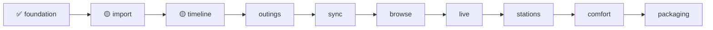
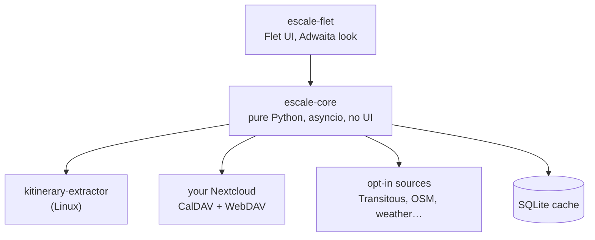

<div align="center">

# 🧳 Escale

**Your trips, on your devices, on your terms.**

A privacy-first travel companion: train, bus and flight tickets, hotels and event
tickets in one timeline per trip — kept in step across Linux and Android through
**your own Nextcloud**. A GNOME-styled cousin of [KDE Itinerary](https://apps.kde.org/itinerary/).

[](https://github.com/jaegerbobomb/escale/actions/workflows/quality.yml)
[](https://github.com/jaegerbobomb/escale/actions/workflows/stories.yml)
[](LICENSE)

-lightgrey)
[](https://flet.dev)
[](https://github.com/jaegerbobomb/story-spec)

</div>

> [!WARNING]
> **Early development.** Escale runs on Linux and shows real imported trips, but sync,
> real time and the Android app are not there yet. Not ready for your next holiday.

## ✨ Why Escale

- 🔒 **Local first.** Everything works offline. The only network calls are the ones you
  switch on, source by source.
- ☁️ **No account of ours.** Your devices sync through your Nextcloud calendar and files.
  Escale hosts nothing and sees nothing.
- 🤝 **Speaks KDE Itinerary.** Same JSON-LD data, same calendar format, same document
  layout: KDE Itinerary can read what Escale writes.
- 🙋 **Nothing silent.** Every import is confirmed; a disabled button tells you why.
- 🎨 **Feels at home on GNOME.** An Adwaita look that adapts from desktop to phone width.

## 🚆 What it does today

- **Import tickets** — PDF, pkpass, e-mail… read on your machine by KDE's
  `kitinerary-extractor`, then confirmed before anything is saved.
- **See the trip you are on** — bookings grouped into trips, the current one as a
  timeline with a "next" card, a jump index and a detail page for every segment.
- **Show your ticket** — full screen with its barcode, offline, one tap from the header.
- **Know where you sleep** — stay details (address, room, contact, "Manage booking on
  Booking.com / Airbnb"), and an editor to fix them.
- **Share a flight** — a Flightradar24 link so whoever picks you up can follow it live.

## 🗺️ Where it is going



| Epic | What you get | Done |
|---|---|---|
| `foundation` | the app shell, light and dark, desktop to phone | 2 / 2 |
| `import` | tickets, stays, shared places, Booking/Airbnb, a KDE Itinerary export | 3 / 12 |
| `timeline` | the current trip, tickets, editors for every kind of booking | 9 / 15 |
| `outings` | a dinner and a concert as one evening out | 0 / 3 |
| `sync` | Linux and Android in step through Nextcloud | 0 / 5 |
| `browse` | all your trips, statistics | 0 / 3 |
| `live` | delays, platforms, alternatives, notifications (Transitous) | 0 / 9 |
| `stations` | station maps, where your coach stops | 0 / 2 |
| `comfort` | country changes, weather, trip map, Matrix location sharing | 0 / 8 |
| `packaging` | Flatpak, signed APK, iOS later | 0 / 4 |

Each epic's exit criteria are in the [roadmap](docs/explanation/roadmap.md).

## 🧩 How it is built



The core never imports the UI (a test enforces it), so a native GTK 4 / libadwaita app
can reuse it later.

## 🛠️ Try it (Linux)

```bash
git clone https://github.com/jaegerbobomb/escale.git && cd escale
sudo apt install libkpim5itinerary5      # Debian/Ubuntu: ships kitinerary-extractor
uv sync --all-packages --all-extras       # needs uv: https://docs.astral.sh/uv/
uv run escale                             # or: uv run escale --web --port 8550
```

Then import a ticket: see [how to import a ticket](docs/how-to/import-a-ticket.md).

## 📚 Read more

| Read | For |
|---|---|
| [Vision](docs/explanation/vision.md) | what Escale is, what it reuses from KDE Itinerary |
| [Roadmap](docs/explanation/roadmap.md) | the ten epics, in order, with their exit criteria |
| [SPEC.md](SPEC.md) | architecture, data model, formats, UI rules |
| [Decisions](docs/adr/README.md) | why Flet, why Nextcloud, why this licence… |
| [Design](docs/design/README.md) | the reference mockup |
| [Changelog](CHANGELOG.md) | what changed, version by version |

## 🤝 Contributing

Every feature starts as a **user story** in [`stories/`](stories/), following
[StorySpec](https://github.com/jaegerbobomb/story-spec): proposed, validated by the
maintainer, then built tests first. Open questions are issues labelled
[`investigation`](https://github.com/jaegerbobomb/escale/labels/investigation) — a good
place to start. Commits are signed off (DCO): see [CONTRIBUTING.md](CONTRIBUTING.md).

<details>
<summary><b>All user stories</b></summary>

| Story | Title | Epic | Status |
|---|---|---|---|
| [S001](stories/S001-workspace-and-core-boundary.md) | Workspace and core boundary | foundation | done |
| [S002](stories/S002-adaptive-shell.md) | Adaptive shell with Adwaita theme | foundation | done |
| [S003](stories/S003-extract-ticket-with-kitinerary.md) | Extract a ticket with kitinerary | import | done |
| [S004](stories/S004-import-confirmation.md) | Import with confirmation | import | done |
| [S005](stories/S005-merge-traveller-batches.md) | Merge reservations into traveller batches | import | deferred |
| [S006](stories/S006-connect-nextcloud-account.md) | Connect a Nextcloud account | sync | split |
| [S006a](stories/S006a-nextcloud-connection-core.md) | Nextcloud connection (core) | sync | done |
| [S006b](stories/S006b-nextcloud-account-preferences.md) | Nextcloud account in the preferences | sync | done |
| [S007](stories/S007-reservation-event-mapping.md) | Map reservations to calendar events | sync | done |
| [S008](stories/S008-two-way-calendar-sync.md) | Two-way calendar sync | sync | split |
| [S008a](stories/S008a-send-changes-to-calendar.md) | Send local reservations to the calendar | sync | done |
| [S008b](stories/S008b-receive-changes-from-calendar.md) | Receive changes from the calendar | sync | done |
| [S008c](stories/S008c-conflicting-edit.md) | A conflicting edit keeps the server version | sync | done |
| [S009](stories/S009-sync-documents.md) | Sync ticket documents | sync | split |
| [S009a](stories/S009a-send-documents.md) | Send ticket documents to Nextcloud | sync | done |
| [S009b](stories/S009b-documents-on-demand.md) | Ticket documents on every device | sync | done |
| [S009c](stories/S009c-document-cache-limit.md) | Limit the space taken by ticket documents | sync | done |
| [S010](stories/S010-trip-grouping-and-timeline.md) | Trip grouping and timeline | timeline | split |
| [S010a](stories/S010a-group-reservations-into-trips.md) | Group reservations into trips | timeline | done |
| [S010b](stories/S010b-current-trip-timeline.md) | Current trip timeline | timeline | done |
| [S010c](stories/S010c-segment-card-densities.md) | Segment card densities | timeline | todo |
| [S011](stories/S011-jump-index-and-segment-detail.md) | Jump index and segment detail | timeline | done |
| [S012](stories/S012-train-segment-editor.md) | Train segment editor | timeline | todo |
| [S013](stories/S013-android-sync-preview.md) | Android build listing synced reservations | sync | todo |
| [S014](stories/S014-local-store-sqlite.md) | Local store in SQLite | import | done |
| [S015](stories/S015-full-screen-ticket.md) | Full-screen ticket, offline | timeline | done |
| [S016](stories/S016-follow-flight-link.md) | Share a flight to follow it live | timeline | done |
| [S017](stories/S017-stay-detail-and-editor.md) | Stay detail and editor | timeline | split |
| [S017a](stories/S017a-stay-detail.md) | Stay detail | timeline | done |
| [S017b](stories/S017b-stay-editor.md) | Stay editor | timeline | done |
| [S018](stories/S018-add-a-stay-by-hand.md) | Add a stay by hand | import | todo |
| [S019](stories/S019-import-a-shared-place.md) | Import a shared place (Google Maps, CoMaps, OpenStreetMap) | import | todo |
| [S020](stories/S020-current-trip-look.md) | Current trip looks like the mockup | timeline | done |
| [S021](stories/S021-current-ticket-shortcut.md) | Shortcut to the current ticket | timeline | done |
| [S022](stories/S022-open-place-in-map-app.md) | Open a place in a map app | timeline | todo |
| [S023](stories/S023-find-a-stay-in-openstreetmap.md) | Find a stay in OpenStreetMap | import | todo |
| [S024](stories/S024-import-booking-airbnb-stays.md) | Import Booking.com and Airbnb stays | import | proposed |
| [S025](stories/S025-share-a-file-to-escale.md) | Share a file to Escale | import | todo |
| [S026](stories/S026-add-a-ticket-barcode.md) | Add a barcode to a reservation | import | proposed |
| [S027](stories/S027-import-online-train-ticket.md) | Import an online train ticket | import | proposed |
| [S028](stories/S028-import-a-kde-itinerary-file.md) | Import a KDE Itinerary file | import | done |
| [S029](stories/S029-flight-segment-editor.md) | Flight segment editor | timeline | todo |
| [S030](stories/S030-bus-and-ferry-editors.md) | Bus and ferry editors | timeline | todo |
| [S031](stories/S031-event-restaurant-car-editors.md) | Event, restaurant and car editors | timeline | proposed |
| [S032](stories/S032-group-bookings-into-outings.md) | Group bookings into outings | outings | proposed |
| [S033](stories/S033-create-an-outing-by-hand.md) | Create an outing by hand | outings | proposed |
| [S034](stories/S034-outing-walks-and-last-ride.md) | Walks and the last ride home | outings | proposed |
| [S035](stories/S035-my-trips-list.md) | My trips list | browse | done |
| [S036](stories/S036-manage-trips.md) | Rename, merge, split, delete trips | browse | proposed |
| [S037](stories/S037-travel-statistics.md) | Travel statistics | browse | proposed |
| [S038](stories/S038-segment-tracking-indicator.md) | Show whether a segment is tracked | live | proposed |
| [S039](stories/S039-network-sources-preferences.md) | One switch per network source | live | proposed |
| [S040](stories/S040-train-real-time.md) | Train delays and platform changes | live | proposed |
| [S041](stories/S041-change-notifications.md) | Notify changes | live | proposed |
| [S042](stories/S042-alternative-connections.md) | Find alternative connections | live | proposed |
| [S043](stories/S043-local-transfers.md) | Local transfers between places | live | proposed |
| [S044](stories/S044-plan-a-train-journey.md) | Plan a train journey | live | proposed |
| [S045](stories/S045-pass-updates.md) | Update passes | live | proposed |
| [S046](stories/S046-onboard-live-status.md) | Live status on board | live | proposed |
| [S047](stories/S047-station-map.md) | Station and airport map | stations | proposed |
| [S048](stories/S048-coach-layout.md) | Coach layout and platform section | stations | proposed |
| [S049](stories/S049-country-change-card.md) | Country change card | comfort | proposed |
| [S050](stories/S050-time-zone-and-dst.md) | Time zone and DST changes | comfort | proposed |
| [S051](stories/S051-weather-forecast.md) | Weather forecast | comfort | proposed |
| [S052](stories/S052-export-itinerary-file.md) | Export an .itinerary file | comfort | proposed |
| [S053](stories/S053-watched-folder.md) | Watched folder on Linux | comfort | proposed |
| [S054](stories/S054-trip-map.md) | Trip map | comfort | proposed |
| [S055](stories/S055-passes-and-programs.md) | Discount cards and passes | comfort | proposed |
| [S056](stories/S056-share-location-matrix.md) | Share my location over Matrix | comfort | proposed |
| [S057](stories/S057-linux-flatpak.md) | Linux package with the extractor | packaging | proposed |
| [S058](stories/S058-signed-release-apk.md) | Signed release APK from a tag | packaging | proposed |
| [S059](stories/S059-first-run-screen.md) | First-run screen | packaging | proposed |
| [S060](stories/S060-ios-build.md) | iOS build | packaging | proposed |
| [S061](stories/S061-detail-and-editor-follow-the-hig.md) | Detail and editor follow the GNOME HIG | timeline | done |
| [S062](stories/S062-transport-detail-looks-like-the-mockup.md) | Transport detail looks like the mockup | timeline | done |
| [S063](stories/S063-gnome-online-accounts.md) | Use the Nextcloud account of GNOME Online Accounts | sync | proposed |

</details>

## 📄 Licence

GPL-3.0-or-later ([LICENSE](LICENSE)), with an App Store notice
([COPYING.iOS](COPYING.iOS)). See [ADR-0006](docs/adr/0006-licence-gpl3-with-app-store-notice.md).

Ticket extraction by [KItinerary](https://invent.kde.org/pim/kitinerary) (KDE).
Escale is not affiliated with KDE.
