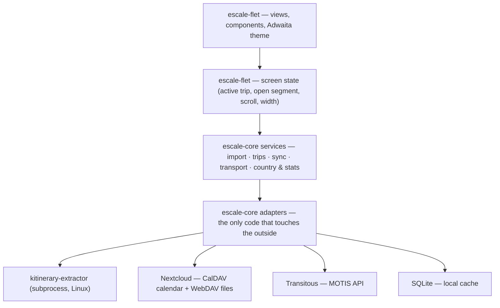

# Escale — project specification

> **This is the project's spec, not StorySpec's.** It describes how Escale is built:
> architecture, conventions, external contracts. Stories say what to build next; this
> file says what every story must respect. When a story contradicts it, this file wins —
> or it is amended first, through an ADR. The story **format** is in
> `stories/README.md`.
>
> Status: **planning**. Nothing below is implemented yet; it is the target the first
> stories build towards.

## Architecture

### Two packages (ADR-0002)

| Package | Contains | May import |
|---|---|---|
| `packages/escale-core` | domain model, import, merge of multi-traveller reservations, trip grouping, Nextcloud sync, public transport, country information, statistics, storage | the standard library and its own dependencies — **never Flet** |
| `packages/escale-flet` | the Flet UI: shell, views, components, theme, screen state | `escale-core`, Flet |

A test in `escale-core` fails if any module of the package imports `flet`. A future
`escale-gtk` (GTK4 + libadwaita through PyGObject) would import the same core.

### Layers



- The UI reads screen state; screen state calls services; services go through adapters.
- **Adapters are the only code that does I/O**: subprocess, HTTP, files, database. Every
  adapter has a fake used by the service tests.
- The core is **asynchronous** (`asyncio`). Flet runs on asyncio; PyGObject ≥ 3.50 can
  run GTK on an asyncio loop (still flagged experimental upstream).
- Reactive screen state lives in each UI package. The core exposes data and events.

### Source of truth (ADR-0004)

The user's **Nextcloud** is the source of truth: the calendar holds the reservations,
the files hold the documents. SQLite is only a local cache, so the app works offline
and restarts fast. Escale hosts nothing.

## Domain model

| Entity | Main fields | Origin |
|---|---|---|
| `Trip` | id, name, kind (`trip` \| `outing`), start, end, destination | automatic grouping or created by hand |
| `ReservationBatch` | one reservation per traveller for the same incidence (same train, same hotel stay) | merge rules at import (see below) |
| `Reservation` | schema.org type (`TrainReservation`, `LodgingReservation`, `EventReservation`, `FlightReservation`, `BusReservation`…), state (`confirmed` \| `planned`), reference, price, raw JSON-LD | `kitinerary-extractor`, Transitous search, manual entry |
| `TrainLeg` | train name/number; departure station, time, platform; arrival station, time, platform; coach, seat, class | the fields of KDE Itinerary's `TrainEditor` — the only editable fields |
| `Realtime` | delay, live platform, cancelled, updated at, **tracking available + reason when not** | Transitous; read-only |
| `Traveller` | name read from the ticket, local alias, avatar | `Reservation.underName` |
| `Document` | id = SHA-256 of the content (pkpass: `pkpass://<passTypeId>/<serial>`), name, MIME type, present locally or not | import |
| `Settings` | home currency, time zone, home place, enabled network sources, notifications, theme | preferences, per device, not synced |

An **outing** is a trip of kind `outing`: same engine, same timeline, same day, no
overnight stay.

**Merge rules at import** (simplified port of KItinerary's `MergeUtil`, Linux only):
the same reservation seen twice is merged; the same incidence for another traveller
is added to the existing batch; anything else starts a new batch.

## External contracts

### Calendar events (CalDAV) — ADR-0004

One reservation batch = one `VEVENT` in a dedicated calendar (default name
"Voyages"/"Trips", chosen at setup).

- `X-KDE-KITINERARY-RESERVATION`: the batch as a **JSON array** of schema.org JSON-LD
  reservations — the exact property KItinerary writes, so KDE Itinerary can import the
  events.
- `UID`: prefixed `KIT-`, as KItinerary does.
- `SUMMARY`, `DTSTART`, `DTEND`, `LOCATION` filled for any calendar client.
- `X-ESCALE-TRIP`: trip id and name when the user named or forced a grouping.
- `X-ESCALE-STATE`: `planned` for a segment added from a search, absent when confirmed.

Sync: `sync-collection` report (RFC 6578) with the stored sync-token; writes with
`If-Match` on the known ETag; a `412` is a conflict — in v1 the server wins and the user
is told. Fallback without sync-token support: compare ETags of the whole calendar.

### Documents (WebDAV) — ADR-0004

Same layout as KDE Itinerary's local storage, under `Escale/` in the user's Nextcloud
files:

```text
Escale/
├─ documents/<sha256>/meta.json      # schema.org CreativeWork: name, encodingFormat
├─ documents/<sha256>/<file name>    # the PDF or image, unchanged
└─ passes/<passTypeId>/<serial>.pkpass
```

A reservation points to its documents through schema.org `subjectOf`. A document never
changes (its id is its content), so there is no conflict: upload what is missing,
download on demand, and in advance for the current trip.

### Ticket extraction — ADR-0003

`kitinerary-extractor <file>` prints schema.org JSON-LD on stdout. Escale calls it as a
subprocess, on Linux only, with the static build shipped with the Linux package. On
mobile, reservations arrive through the sync. The `.itinerary` export of KDE Itinerary
is a zip with the same `reservations/`, `passes/`, `documents/<id>/` layout.

### Public transport — ADR-0005

Transitous (MOTIS API) for station search, journey search, real-time data and
alternatives. Each network source can be turned off individually in the preferences.
**Flights have no live tracking in v1**: the segment shows "No live tracking for this
flight", and the refresh action says why it is disabled.

## User interface

### Navigation model (ADR-0007)

- Three top-level views: **Current**, **My trips**, **Statistics**.
- The stacked **timeline** of a trip is its home screen. The left index only jumps and
  highlights; it never changes what is shown.
- Clicking a segment card opens its **editable detail**; "‹ <trip name>" goes back to
  the same scroll position with the card highlighted.
- Opened from **Current**, a trip keeps the tabs; opened from **My trips**, it is a
  pushed page and the tabs give way to a back button.

| Width | Tabs | Jump index | Segment detail |
|---|---|---|---|
| ≥ 550 px | segmented control in the header | left panel | replaces the content, tabs kept |
| 400–550 px | bottom navigation bar | "Jump to…" menu | replaces the content, tabs kept |
| < 400 px | bottom navigation bar | bottom sheet | pushed page, bottom bar hidden |

### Look

Adwaita-like theme on every platform: Cantarell / Adwaita Sans, accent `#3584e4`, light
and dark. State colours are theme tokens, never hard-coded in components:

| State | Meaning |
|---|---|
| success | on time, confirmed |
| warning | delayed, tight connection |
| error | cancelled |
| accent | planned (added from a search, not booked) |
| purple `#9141ac` | outing |

Each segment shows its **tracking state**: "Live tracking" when a source exists, "No
live tracking" with the reason otherwise. "Refresh" is enabled only when something can
be refreshed.

### libadwaita → Flet

The mockup is drawn with libadwaita widgets; Escale renders them with Flet. Control
names to confirm against the Flet 1.1 docs when the story is implemented.

| Mockup | Flet |
|---|---|
| `AdwApplicationWindow` + `AdwToolbarView` | `Page` + `View` with `AppBar` |
| `AdwViewSwitcher` / `AdwViewSwitcherBar` | `SegmentedButton` in the app bar / `NavigationBar` |
| `AdwNavigationSplitView` + jump index | `Row`: `ListView` panel + content |
| pushed page | declarative router |
| `AdwSplitButton` "Add" | filled button + menu button side by side |
| `AdwBanner` | `Banner` |
| `.boxed-list`, `.card` | `Card` + `ListTile` |
| `AdwExpanderRow` | `ExpansionTile` |
| `AdwBottomSheet` | `BottomSheet` |
| `AdwPreferencesDialog` | settings `View` with `Switch`, `Dropdown` |
| `AdwToggleGroup` | `SegmentedButton` |

Segment cards come in three densities from one component: **compact** (dense lists),
**detailed** (default timeline), **disruption** (cancellation in focus, recovery action
visible without a click).

## Conventions

- Python ≥ 3.12, type hints everywhere, `mypy --strict` on `escale-core`.
- `ruff` for lint and format. No other formatter.
- Tests: `pytest`; BDD scenarios with `pytest-bdd` from the generated features. Service
  tests use the adapter fakes; adapter tests run against real tools in CI (a Nextcloud
  container, the `kitinerary-extractor` binary) and are marked so they can be skipped
  locally.
- Times are timezone-aware everywhere; a naive `datetime` in the core is a bug.
- No network call without its source being enabled in the preferences.
- Nothing is saved silently: every import goes through a confirmation.

<!-- BEGIN story-spec:spec-sections (generated by init.sh from the enabled modules — do not edit by hand) -->

## Architecture Decision Records

Architecture decisions live in `docs/adr/NNNN-slug.md` (lightweight MADR format, cf.
`modules/adr/templates/NNNN-title.md`).

- **Single source** of structural decisions: what is in an `accepted` ADR is authoritative.
  `SPEC.md` describes the current state; ADRs describe **why** we got there and the history.
- Sequential `NNNN` numbering, never reused; an ADR is never deleted — it is
  `superseded`/`deprecated`.
- A story can reference its decisions via the frontmatter field `adr: [NNNN, …]`.
- Index: `docs/adr/README.md` (generatable table, status + title + date).
<!-- END story-spec:spec-sections -->
