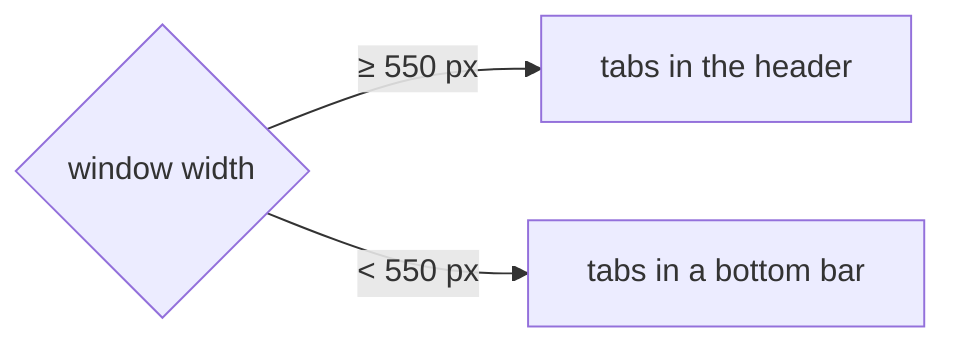

## User story

> **As a** traveller, **I want** the app to open on my current trip with its tabs placed
> for my screen, **so that** it is usable on a laptop and on a phone.

## Diagram

## Technical description

- `escale_flet`: app entry point, shell with three views — Current, My trips,
  Statistics — each an empty placeholder for now.
- Breakpoint at 550 logical px (ADR-0007): segmented control in the app bar above it,
  `NavigationBar` below it. Reacts to resizing without restart.
- Theme module: Adwaita-like palette and typography, light and dark following the
  system, state colours (success, warning, error, accent, outing purple) as tokens
  (`SPEC.md` § Look).
- "Add" split button in the header (menu entries present, disabled until their
  stories exist).
- UI tests drive the Flet page at given widths; no pixel assertions.

## Acceptance Criteria

### Scenario: Wide window shows the tabs in the header

* **Given** the app is open in a window 1000 px wide
* **Then** the tabs "Current", "My trips" and "Statistics" are in the header
* **And** no bottom navigation bar is shown

### Scenario: Narrow window moves the tabs to the bottom

* **Given** the app is open in a window 1000 px wide
* **When** the window is resized to 500 px wide
* **Then** the tabs are in a bottom navigation bar
* **And** the selected tab is still selected

### Scenario: The app opens on the current trip

* **When** the app starts
* **Then** the "Current" tab is selected

### Scenario: Dark system theme

* **Given** the system prefers a dark theme
* **When** the app starts
* **Then** the app uses the dark variant of the theme

## Notes

- First UI story: needs the screenshot tool from issue #11, and its PR is validated
  from screenshots shown in the session (see `CLAUDE.md`).
- The 400 px breakpoint only matters once a trip and a segment detail exist (S011).
