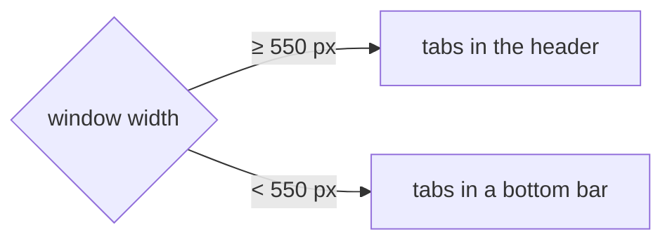

## User story

> **As a** traveller, **I want** the app to open on my current trip with its tabs placed
> for my screen, **so that** it is usable on a laptop and on a phone.

## Diagram

## Technical description

- `escale_flet`: app entry point, shell with three views — Current, My trips,
  Statistics — each an empty placeholder for now.
- Breakpoint at 550 logical px (ADR-0007): segmented control in the app bar above it,
  `NavigationBar` below it. Reacts to resizing without restart.
- Theme module: Adwaita-like palette and typography, light and dark following the
  system, state colours (success, warning, error, accent, outing purple) as tokens
  (`SPEC.md` § Look).
- "Add" split button in the header (menu entries present, disabled until their
  stories exist).
- UI tests drive the Flet page at given widths; no pixel assertions.

## Acceptance Criteria

### Scenario: Wide window shows the tabs in the header

* **Given** the app is open in a window 1000 px wide
* **Then** the tabs "Current", "My trips" and "Statistics" are in the header
* **And** no bottom navigation bar is shown

### Scenario: Narrow window moves the tabs to the bottom

* **Given** the app is open in a window 1000 px wide
* **When** the window is resized to 500 px wide
* **Then** the tabs are in a bottom navigation bar
* **And** the selected tab is still selected

### Scenario: The app opens on the current trip

* **When** the app starts
* **Then** the "Current" tab is selected

### Scenario: Dark system theme

* **Given** the system prefers a dark theme
* **When** the app starts
* **Then** the app uses the dark variant of the theme

## Notes

- 2026-11-24: validated by the maintainer (`proposed` → `todo`), delivered in 0.2.0.
- Screenshots (issue #11): Flet's web client served on localhost and driven by
  Playwright, `tools/screenshots.py`, every view at 1000/500/380 px, light and dark;
  also run by CI as an artifact. Flet's own `flet.testing` needs the Flutter SDK: kept
  for later. See `docs/how-to/capture-screenshots.md`.
- UI tests drive the shell through a stand-in for `ft.Page` (same attributes, same
  resize event): the real page needs a connected Flutter client.
- Choices to confirm on the screenshots: "Add" menu entries "Import a ticket…", "New
  trip…", "Search a train…" (the mockup is not in the repository yet); the main "Add"
  button is disabled like its menu entries; empty views in the style of libadwaita's
  status page.
- Each view opens from a route (`/trips`, `/statistics`), so the screenshot tool does not
  have to click through a canvas.
- Font: Adwaita Sans 49.0, latin subset only (the GNOME servers are not reachable from
  the build environment; taken from `@fontsource/adwaita-sans`). Flet maps one file per
  family, so the bold weight is the family `Adwaita Sans Bold`.
- The 400 px breakpoint only matters once a trip and a segment detail exist (S011).
- 2026-11-26, S061 (ADR-0008): the "Add" split button is flat and sits at the start of
  the header bar, as the GNOME HIG asks for main actions; it was blue and on the right,
  as in the mockup.
