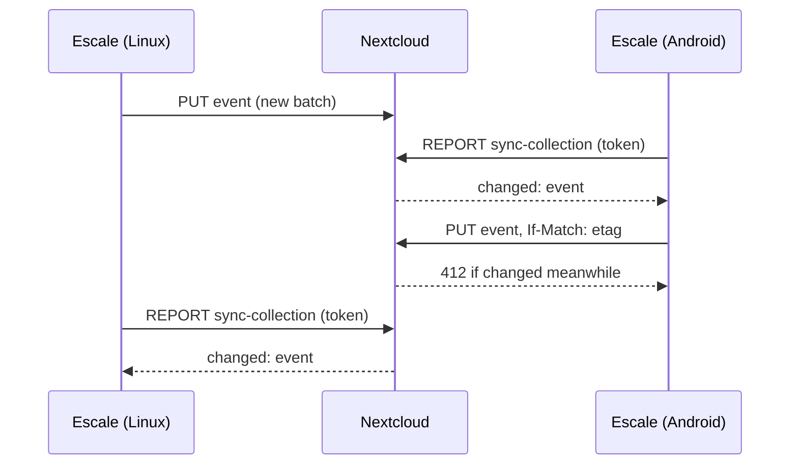

## User story

> **As a** traveller with a laptop and a phone, **I want** a change on one to appear on
> the other, **so that** I never wonder which device is right.

## Diagram

## Technical description

- Core service `sync`: at start, on demand and periodically, `sync-collection` with the
  stored sync-token; apply added/changed/removed events to the SQLite cache by UID.
- Local changes go through an outbox: PUT with `If-Match`; on `412`, reload the event,
  keep the server version (v1) and emit a "changed elsewhere" notice for the UI.
- Fallback when the server refuses sync-tokens: compare ETags of the whole calendar.
- Works offline: the outbox is flushed when the server is reachable again.
- Split into sub-stories if it exceeds a day (likely: pull, push, conflict).

## Acceptance Criteria

### Scenario: A reservation imported on one device appears on another

* **Given** two devices connected to the same calendar
* **When** a reservation is saved on the first device
* **And** the second device syncs
* **Then** the second device shows the reservation

### Scenario: An edit made offline is sent later

* **Given** a device without network
* **When** the user edits a reservation
* **And** the network comes back
* **Then** the edit is on the server

### Scenario: A conflicting edit keeps the server version

* **Given** a reservation edited on the server since the device last synced
* **When** the device sends its own edit of that reservation
* **Then** the device shows the server version
* **And** the user is told the reservation changed elsewhere

### Scenario: A reservation deleted elsewhere disappears

* **Given** two devices showing the same reservation
* **When** it is deleted on the first device
* **And** the second device syncs
* **Then** the second device no longer shows it

## Notes

- 2026-11-24: validated by the maintainer (`todo`).
