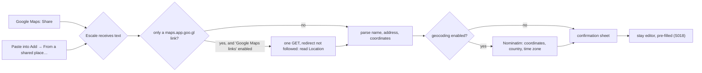

## User story

> **As a** traveller who found where to sleep on Google Maps or CoMaps, **I want** to
> share the place to Escale, **so that** it becomes a stay without typing its address.

## Diagram

## Technical description

- **Input.** On Android (later iOS), Escale is a share target for `text/plain`; on
  every platform, "Add → From a shared place…" accepts pasted text. Receiving share
  intents in a Flet app is an open question (investigation issue).
- **What Google actually shares.** A share from the Google Maps Android app is **only a
  short link**, e.g. `https://maps.app.goo.gl/<id>?g_st=ac` (sample from the maintainer,
  2026-11-24): no name, no address, no coordinates in the text. The name and address
  are only in the URL the short link redirects to:
  `302 Found`, `Location: https://www.google.com/maps/place/<Name>,+<locality>,+<town>,+<country>/data=!4m2!3m1!1s0x<hex>:0x<hex>!18m1!1e1?…`.
  That target carries the place name and address in its path, and Google's feature id
  in `data` (`!1s0x…:0x…`); in this sample, **no coordinates**. Other shares (website,
  iOS, a `place/…/@lat,lng` URL) may differ: samples in the investigation issue.
- **Resolving the short link (one request to Google, opt-in).** With the network source
  "Google Maps links" enabled — off by default; its description says a request goes to
  Google for each shared link — the core sends **one** `GET` to `maps.app.goo.gl/<id>`
  **without following redirects**, reads the `Location` header and stops there: no
  request to `google.com`, no cookies, no page parsed. Disabled, a bare short link is
  refused with a message telling how to enable the source or to share the address as
  text instead.
- **Parsing (core, no network).** From a `google.com/maps/place/<path>` URL (resolved
  or pasted): the first segment of the path, URL-decoded and split on commas, gives the
  name (first part) and the address (the rest, country last); `/@lat,lng` gives the
  coordinates when present. From shared text with a name and address lines (other
  apps, the website), the same fields from the lines. An
  `openstreetmap.org/node|way|relation/<id>` link is accepted too, as KDE Itinerary
  does. The parser is pure and tested against the fixtures of the investigation issue.
- **CoMaps (and OsmAnd).** According to the OpenStreetMap wiki, CoMaps shares a location
  as a `geo:` URI plus a `comaps.app` link. A `geo:lat,lng` URI gives the coordinates
  with no network at all; the label, when present (`?q=lat,lng(Name)`, Android's
  convention), gives the name. The address then comes from Nominatim if "Address
  lookup" is enabled, else the user types it. The exact CoMaps share text is to be
  collected in the investigation issue, like Google's.
- **Not used.** Google's Maps "Resolution API" (needs a key, experimental); scraping the
  Maps page.
- **Geocoding, optional.** With the "Address lookup" network source enabled (off by
  default), the address is sent to Nominatim (OpenStreetMap) for coordinates and
  country, which give the time zone — needed for the sample above, which has none; KDE Itinerary does the same. Respect Nominatim's
  usage policy (identified user agent, at most one request per second).
- **Confirmation.** As every import (S004): a sheet shows what was understood; "Add as a
  stay" opens the stay editor of S018 pre-filled, the dates left for the user to set.
  Android's guidance says the same: let the user confirm and edit shared content.
- Later kinds (restaurant, place to visit) come with the `outings` epic.

## Acceptance Criteria

### Scenario: A shared place becomes a pre-filled stay

* **Given** the shared text of a Google Maps place "Hôtel du Nord" at "102 Quai de Jemmapes, 75010 Paris" with its link
* **When** Escale receives it
* **And** the user chooses "Add as a stay"
* **Then** the stay editor shows the name "Hôtel du Nord" and the city "Paris"
* **And** the check-in and check-out are empty

### Scenario: Coordinates from a full Google Maps link

* **Given** a pasted link `https://www.google.com/maps/place/H%C3%B4tel+du+Nord/@48.8721,2.3651,17z`
* **When** Escale parses it
* **Then** the place has the coordinates 48.8721, 2.3651

### Scenario: A short link is resolved with one request

* **Given** the network source "Google Maps links" is enabled
* **And** `maps.app.goo.gl/<id>` redirects to `https://www.google.com/maps/place/H%C3%B4tel+du+Nord,+102+Quai+de+Jemmapes,+75010+Paris,+France/data=!4m2!3m1!1s0x1:0x2`
* **When** Escale receives the short link
* **Then** exactly one request is made, to `maps.app.goo.gl`
* **And** the place is named "Hôtel du Nord" in "Paris", "France"

### Scenario: A short link with the source disabled

* **Given** the network source "Google Maps links" is disabled
* **When** Escale receives a `maps.app.goo.gl` link
* **Then** no network request is made
* **And** the sheet explains how to enable the source or share the address as text

### Scenario: A place shared from CoMaps

* **Given** a shared text containing `geo:48.8721,2.3651?q=48.8721,2.3651(Hôtel du Nord)`
* **When** Escale receives it
* **Then** the place is named "Hôtel du Nord" with the coordinates 48.8721, 2.3651
* **And** no network request is made

### Scenario: Text that is not a place

* **Given** a shared text "see you tomorrow"
* **When** Escale receives it
* **Then** the sheet says no place was recognised and offers "Add manually"

## Notes

- Asked by the maintainer (2026-11-24), with the requirement that stays be manageable
  first (S017, S018).
- 2026-11-24: the maintainer's real Android share was a bare short link. The first
  draft ("no request to Google, parse the shared text") could not work: resolving the
  link is the only way, so it became an opt-in source with a single, non-followed
  request.
