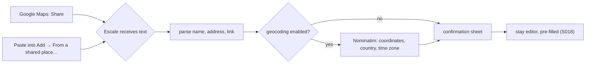

## User story

> **As a** traveller who found where to sleep on Google Maps, **I want** to share the
> place to Escale, **so that** it becomes a stay without typing its address.

## Diagram

## Technical description

- **Input.** On Android (later iOS), Escale is a share target for `text/plain`; on
  every platform, "Add → From a shared place…" accepts pasted text. Receiving share
  intents in a Flet app is an open question (investigation issue).
- **Parsing (core, no network).** A Google Maps share is, as far as we know, the place
  name, its address on one or more lines, and a link (`maps.app.goo.gl/…` or
  `google.com/maps/place/…`). The exact format must be confirmed on real samples from
  the Android and iOS apps and the website, in French and English (investigation
  issue). The parser extracts the name, the address parts and the link; a full
  `google.com/maps/place/…/@lat,lng…` URL also gives coordinates. An
  `openstreetmap.org/node|way|relation/<id>` link is accepted too, as KDE Itinerary
  does.
- **No request to Google.** The short link is kept as the place's `url` but never
  followed: following it would send a request to Google for every import, and is not a
  documented API. The Maps "Resolution API" needs a key and is experimental.
- **Geocoding, optional.** With the "Address lookup" network source enabled (off by
  default), the address is sent to Nominatim (OpenStreetMap) for coordinates and
  country, which give the time zone; KDE Itinerary does the same. Respect Nominatim's
  usage policy (identified user agent, at most one request per second).
- **Confirmation.** As every import (S004): a sheet shows what was understood; "Add as a
  stay" opens the stay editor of S018 pre-filled, the dates left for the user to set.
  Android's guidance says the same: let the user confirm and edit shared content.
- Later kinds (restaurant, place to visit) come with the `outings` epic.

## Acceptance Criteria

### Scenario: A shared place becomes a pre-filled stay

* **Given** the shared text of a Google Maps place "Hôtel du Nord" at "102 Quai de Jemmapes, 75010 Paris" with its link
* **When** Escale receives it
* **And** the user chooses "Add as a stay"
* **Then** the stay editor shows the name "Hôtel du Nord" and the city "Paris"
* **And** the check-in and check-out are empty

### Scenario: Coordinates from a full Google Maps link

* **Given** a pasted link `https://www.google.com/maps/place/H%C3%B4tel+du+Nord/@48.8721,2.3651,17z`
* **When** Escale parses it
* **Then** the place has the coordinates 48.8721, 2.3651

### Scenario: Nothing is sent to Google

* **Given** the shared text of a Google Maps place with a `maps.app.goo.gl` link
* **When** Escale parses it
* **Then** no network request is made to a Google host

### Scenario: Text that is not a place

* **Given** a shared text "see you tomorrow"
* **When** Escale receives it
* **Then** the sheet says no place was recognised and offers "Add manually"

## Notes

- Asked by the maintainer (2026-11-24), with the requirement that stays be manageable
  first (S017, S018).
